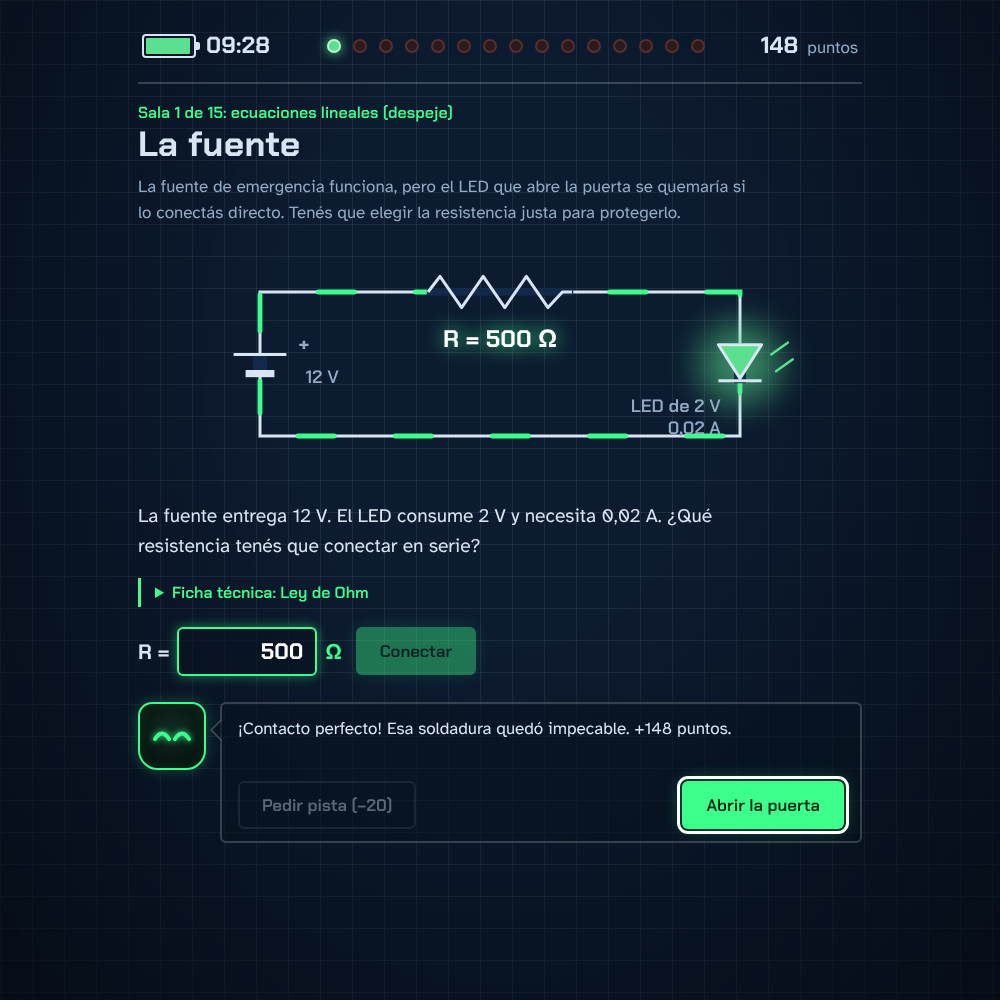

# Cortocircuito: Escape del Laboratorio

Escape room educativo de matemática con temática de circuitos electrónicos. Proyecto final de **Proyecto Integrador III**.

Un cortocircuito dejó el Laboratorio 7 sin energía. El jugador tiene **10 minutos** para resolver las 15 salas: en cada una hay un circuito que se arregla aplicando un tema de matemática (ecuaciones, porcentajes, fracciones, funciones, sistemas de ecuaciones...). Lo guía *Ohmi*, un robot de soldadura que da pistas y reacciona a cada respuesta.

**▶ Jugar online:** https://mrmaito.github.io/CortocircuitoGame/



## Jugar en tu compu

El juego necesita un servidor local (abrir `index.html` con doble clic **no funciona**, porque el navegador bloquea la carga de `data/salas.json`). Los scripts lo resuelven solos:

| Sistema | Qué hacer | Hace falta instalar |
| --- | --- | --- |
| **Windows** | Doble clic en **`jugar.bat`** | Nada |
| Linux / macOS | `./jugar.sh` | Python 3 (ya viene instalado) |

Se abre el navegador con el juego. Para cerrarlo, cerrá la ventana negra (o `Ctrl + C`).

> Si Windows muestra "Windows protegió su PC", tocá **Más información → Ejecutar de todas formas**. Pasa con cualquier archivo `.bat` bajado de internet.

## Correr los tests

| Sistema | Qué hacer | Hace falta instalar |
| --- | --- | --- |
| **Windows** | Doble clic en **`tests.bat`** | [Node.js](https://nodejs.org) (versión LTS) |
| Linux / macOS | `npm test` | Node.js 18 o superior |

Son 74 tests: validación de respuestas, reglas del juego (timer, puntaje, pistas) y revisión de que las 45 preguntas estén bien cargadas.

## Documentación

| Documento | Para qué sirve |
| --- | --- |
| [Guía del equipo](docs/GUIA-EQUIPO.md) | **Empezá por acá.** Contexto del proyecto, qué está hecho, qué falta y cómo trabajamos con Git. |
| [Arquitectura](docs/ARQUITECTURA.md) | Cómo está armado el código, cómo agregar o cambiar salas y dónde se configura el juego. |
| [QA y pruebas](docs/QA.md) | Tests automáticos, checklist de prueba manual, pruebas de usabilidad y cómo reportar bugs. |
| [Catálogo de salas](docs/SALAS.md) | Las 15 salas con su contenido de matemática, enunciados, respuestas y pistas. Sirve para el informe pedagógico. |

## Estructura

```
index.html          las tres pantallas: inicio, juego y final
css/estilos.css     todo el diseño
js/                 la lógica del juego (ver docs/ARQUITECTURA.md)
data/salas.json     las 15 salas y sus 45 desafíos
assets/fuentes/     tipografías (incluidas para que funcione sin internet)
tests/              tests automáticos
tools/              servidor para Windows y scripts que generan salas y documentación
docs/               documentación
jugar.bat / .sh     doble clic para jugar
tests.bat           doble clic para correr los tests
```

## Licencia

Código bajo licencia [MIT](LICENSE). Las tipografías Chakra Petch y Atkinson Hyperlegible tienen licencia SIL Open Font License.
