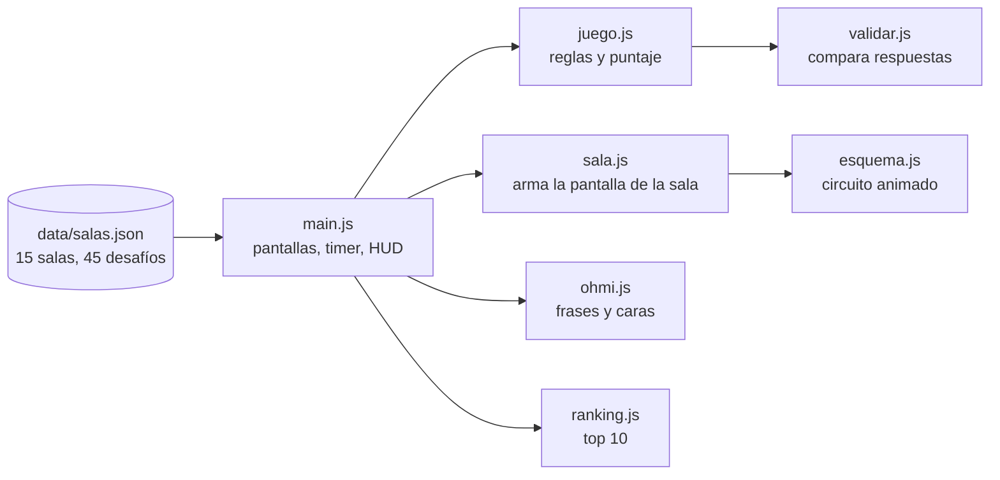
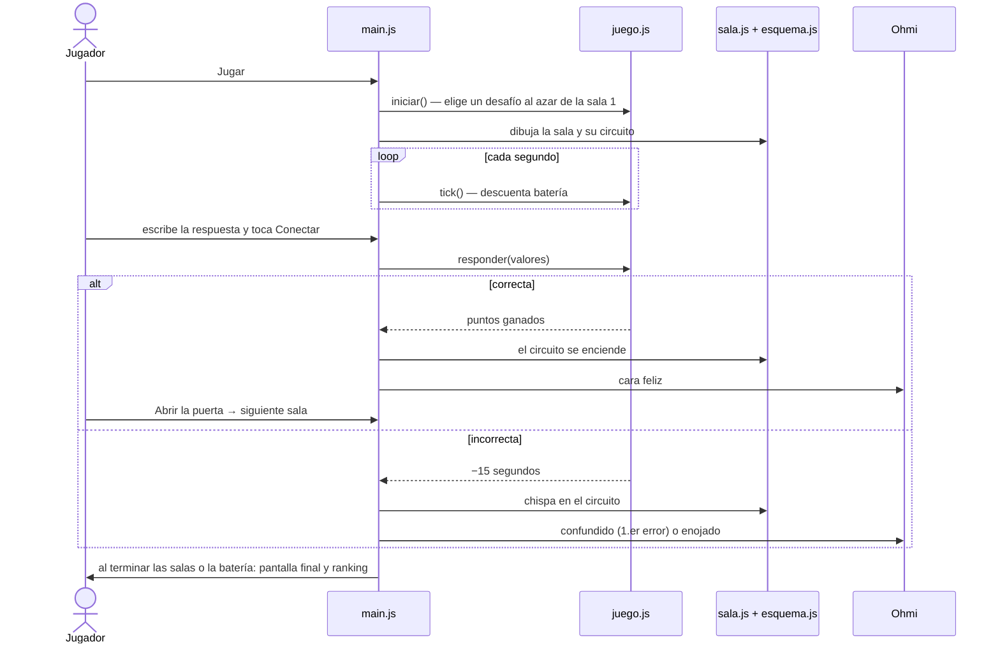
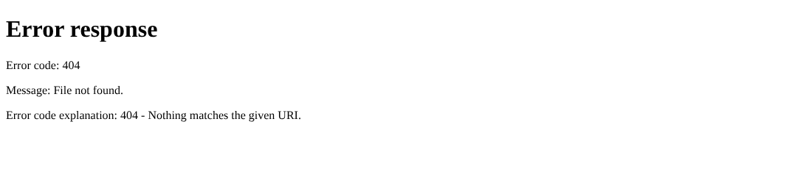

# Arquitectura

Cortocircuito es una **página web estática**: HTML, CSS y JavaScript puro, sin frameworks, sin dependencias y sin paso de compilación. Todo corre en el navegador del jugador; no hay servidor ni base de datos. Por eso se puede publicar gratis en GitHub Pages y jugar desde cualquier compu o celular.

## Cómo encajan las piezas



| Archivo | Qué hace | ¿Toca la pantalla? |
| --- | --- | --- |
| `js/main.js` | Arranca el juego, carga las salas, maneja las tres pantallas, el timer, el HUD (batería, LEDs, puntaje) y la oscuridad del laboratorio. Conecta todo lo demás. | Sí |
| `js/juego.js` | **Las reglas:** sala actual, tiempo restante, puntaje, pistas, errores y fin de partida. Tiene la configuración (`CONFIG`). | No, por eso se puede testear |
| `js/validar.js` | Interpreta lo que escribe el jugador ("350", "350,0", "350 Ω") y lo compara con la respuesta con un margen del ±1 %. | No |
| `js/sala.js` | Arma la pantalla de una sala: título, historia, circuito, enunciado, ficha técnica y casilleros de respuesta. | Sí |
| `js/esquema.js` | Dibuja el circuito de cada sala en SVG y lo anima al acertar (corriente que circula) o al errar (chispa). | Sí |
| `js/ohmi.js` | Las frases de Ohmi y sus 7 caras. | Sí |
| `js/ranking.js` | Guarda el top 10 en el navegador (`localStorage`). | No |
| `css/estilos.css` | Todo el diseño: colores, tipografías, animaciones y versión para celular. | — |

## Qué pasa durante una partida



## Configuración del juego

Todo lo que define la dificultad está en `CONFIG`, al principio de `js/juego.js`:

| Valor | Hoy | Qué controla |
| --- | --- | --- |
| `duracion` | `10 * 60` | Segundos de batería de toda la partida |
| `penalizacionError` | `15` | Segundos que resta cada respuesta incorrecta |
| `puntosBase` | `100` | Puntos por resolver una sala |
| `bonusMaximo` | `60` | Bonus por rapidez: 60 menos los segundos que tardaste en la sala |
| `costoPistas` | `[10, 20, 30]` | Puntos que cuesta la 1.ª, 2.ª y 3.ª pista de cada sala |

Si cambiás `duracion`, actualizá también el texto "10 minutos" y el "10:00" de `index.html`.

## Formato de `data/salas.json`

Cada sala tiene sus datos fijos y una lista de desafíos. En cada partida se elige uno de los desafíos al azar.

```json
{
  "numero": 1,
  "id": "fuente",
  "nombre": "La fuente",
  "tema": "Ecuaciones lineales (despeje)",
  "historia": "Texto que cuenta qué pasa en la sala...",
  "ficha": {
    "titulo": "Ley de Ohm",
    "formula": "V = I · R",
    "explicacion": "Texto que explica cómo usar la fórmula..."
  },
  "desafios": [
    {
      "id": "sala1-led-9v",
      "enunciado": "La fuente entrega 9 V. El LED consume 2 V y necesita 0,02 A. ¿Qué resistencia...?",
      "respuestas": [{ "etiqueta": "R", "valor": 350, "unidad": "Ω" }],
      "tolerancia": 0.01,
      "pistas": ["Pista general", "Pista más concreta", "Casi la respuesta"],
      "esquema": { "tipo": "serie-led", "fuente": "9 V", "led": ["LED de 2 V", "0,02 A"] }
    }
  ]
}
```

- `respuestas` puede tener más de una (la sala 2 pide R e I). El jugador tiene que acertar todas.
- `valor` es siempre un **número**, no un texto: `350`, no `"350"`.
- `tolerancia` es el margen aceptado: `0.01` = ±1 %.
- `pistas`: entre 1 y 3, de la más general a la más concreta.
- `esquema` es opcional. Si falta, la sala se juega igual, sin dibujo.

`tests/salas.test.js` revisa todas estas reglas. **Correlo siempre después de tocar las salas.**

## Cómo agregar o cambiar desafíos

Las respuestas **no se escriben a mano**: las calcula `tools/generar_salas.py` a partir de los datos de cada desafío. Así no hay errores de cuentas ni de tipeo.

1. Abrí `tools/generar_salas.py`. Cada sala tiene una función que arma sus desafíos; por ejemplo, la sala 5:
   ```python
   [d_tolerancia(1000, 5), d_tolerancia(220, 10), d_tolerancia(4700, 2)]
   ```
   Para sumar un desafío, agregá otra llamada con valores nuevos: `d_tolerancia(330, 5)`.
2. Regenerá el JSON y el catálogo de salas:
   ```
   python tools/generar_salas.py data/salas.json data/salas.json
   python tools/generar_doc_salas.py
   ```
3. Corré los tests (`tests.bat` o `npm test`) y jugá la sala.

Hace falta [Python 3](https://www.python.org/downloads/) (en Windows, tildá "Add Python to PATH" al instalarlo).

> **Excepción:** las salas 1, 2 y 7 (La fuente, El almacén y El tablero) se escribieron antes que el generador. El script las copia tal cual del JSON, así que esas tres se editan directamente en `data/salas.json`. Si cambiás una respuesta ahí, hacé la cuenta dos veces.

## Los circuitos (`js/esquema.js`)

Cada desafío indica en `esquema.tipo` qué dibujo usa. Cada tipo es una función que recibe los datos y devuelve un SVG.

| Tipo | Salas | Datos que usa |
| --- | --- | --- |
| `serie-led` | 1 | `fuente`, `led` |
| `conversion` | 2 | `items` (símbolo y valor de cada componente) |
| `binario` | 3 | `bits` |
| `colores` | 4 | `bandas` |
| `tolerancia` | 5 | `nominal`, `tolerancia` |
| `lampara` | 6, 10, 12 | `simbolo` (`lampara` o `resistencia`), `datos`, `fuente` (opcional) |
| `paralelo` | 7 | `r1`, `r2`, `serie` (opcional) |
| `divisor` | 8 | `fuente`, `r1`, `r2` |
| `transformador` | 9 | `izquierda`, `derecha` (rótulos de cada bobinado) |
| `grafico-vi` | 11 | `puntos` (dos pares tensión-corriente) |
| `puente` | 13 | `r1`, `r2`, `r3` |
| `senoidal` | 14 | `periodo`, `vmax`, `angulo` |
| `kirchhoff` | 15 | `total`, `r1`, `r2` |

Para crear un tipo nuevo: escribí la función usando las piezas que ya existen (`resistenciaH`, `resistenciaV`, `bateria`, `chispa`, `incognita`), agregala a `TIPOS` al final del archivo, y usala en un desafío con `"esquema": { "tipo": "tu-tipo", ... }`. Los textos con `incognita(...)` son los que muestran "R = ?" y se reemplazan por el resultado al acertar.

## Ohmi

| Cara | Cuándo aparece |
| --- | --- |
| Feliz | Al empezar y al acertar |
| Confundido | En el primer error de cada sala |
| Enojado (en rojo) | Del segundo error en adelante |
| Pensando | Mientras da una pista |
| Triste | Cuando ya no le quedan pistas en la sala |
| Sorprendido | Cuando queda menos de un minuto de batería |
| Neutral | En reposo; parpadea |



Las frases están en `FRASES` y las caras en `CARAS`, las dos en `js/ohmi.js`. Cuándo se usa cada una se decide en `js/main.js` (buscá `gesto(`).

## Diseño visual

- **Concepto:** un plano técnico de un laboratorio a oscuras que se va iluminando a medida que se restaura energía. La variable CSS `--luz` va de 0 a 1 según las salas resueltas.
- **Colores** (al principio de `css/estilos.css`): azul de plano (`--plano`), líneas tipo tiza (`--tiza`) y verde neón como acento (`--neon`). El ámbar y el rojo se reservan para avisos: batería baja, chispas y Ohmi enojado.
- **Tipografías:** Chakra Petch para títulos y números, Atkinson Hyperlegible para el texto (diseñada para leerse fácil). Están en `assets/fuentes/` para que funcione sin internet.
- **Accesibilidad:** se puede jugar solo con teclado (Tab y Enter), el foco se ve siempre y, si la persona configuró su sistema para reducir el movimiento, las animaciones se desactivan.

## Decisiones técnicas

| Decisión | Por qué |
| --- | --- |
| JavaScript puro, sin frameworks | No hay que instalar ni compilar nada; cualquiera del equipo puede leer y tocar el código. |
| Contenido en un JSON aparte | Agregar o corregir preguntas no requiere tocar la lógica del juego. |
| Respuestas generadas por script | Evita errores de cuentas en 45 desafíos. |
| Reglas del juego separadas de la pantalla (`juego.js`) | Se pueden testear automáticamente con Node. |
| Ranking en `localStorage` | No hace falta servidor ni base de datos. La contra: el ranking es de cada navegador, no compartido. |
| GitHub Pages | Publicación gratis y automática con cada cambio en `main`. |
